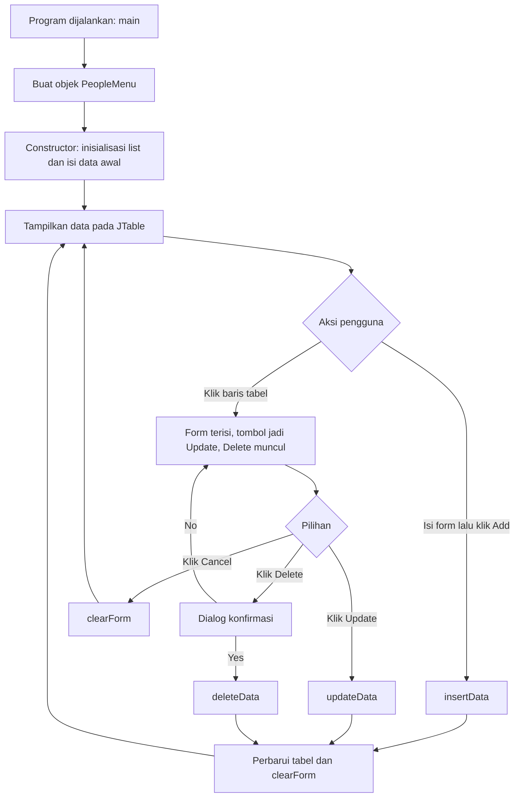

# TP4DPBO2526C2

Aplikasi desktop berbasis **Java Swing** untuk mengelola data civitas kampus dengan operasi **CRUD** (Create, Read, Update, Delete). Dibuat untuk memenuhi Tugas Praktikum 4 mata kuliah Desain Pemrograman Berorientasi Objek (Modul 4: Introduction to Java Swing GUI).

## Janji

```
Saya Bentar Bintang Umeir dengan nim 2509865 mengerjakan TP4 dalam mata kuliah DPBO untuk 
keberkahanNya maka saya tidak melakukan kecurangan seperti yang telah dispesifikasikan. Aamiin
```

---

## 1. Desain Program

### 1.1 Deskripsi Singkat

PeopleData adalah aplikasi manajemen data orang (civitas kampus) dengan tampilan GUI. Data disimpan sementara di memori dalam bentuk `ArrayList<Person>` dan ditampilkan dalam `JTable`. Pengguna dapat menambah, melihat, mengubah, dan menghapus data melalui satu jendela (form) yang sama.

### 1.2 Atribut Data

Setiap data orang (`Person`) memiliki lima atribut:

| No | Atribut | Tipe Data | Komponen Form | Keterangan |
|----|---------|-----------|---------------|------------|
| 1 | `id` | `String` | `JTextField` | Identitas unik, contoh `P001` |
| 2 | `nama` | `String` | `JTextField` | Nama lengkap |
| 3 | `tahunLahir` | `int` | `JTextField` | Harus berupa angka |
| 4 | `kategori` | `String` | `JComboBox` | Mahasiswa, Dosen, Staf, Alumni |
| 5 | `level` | `int` | `JSlider` | **Atribut baru.** Level keahlian 1 sampai 10 |

> Atribut **Level Keahlian** adalah atribut tambahan sesuai ketentuan tugas no. 3. Karena komponennya berupa `JSlider` (bukan `JTextField`), atribut ini memenuhi syarat **bonus**.

### 1.3 Komponen GUI (`PeopleMenu.form`)

| Komponen | Field Name | Fungsi |
|----------|------------|--------|
| `JPanel` | `mainPanel` | Panel utama (content pane window) |
| `JLabel` | `titleLabel` | Judul aplikasi "Data Civitas" |
| `JTextField` | `idField` | Input ID |
| `JTextField` | `namaField` | Input nama |
| `JTextField` | `tahunLahirField` | Input tahun lahir |
| `JComboBox` | `kategoriComboBox` | Pilihan kategori |
| `JSlider` | `levelSlider` | Input level keahlian (1-10) |
| `JLabel` | `levelValueLabel` | Menampilkan nilai slider saat ini |
| `JButton` | `addUpdateButton` | Tombol **Add** atau **Update** (berubah sesuai mode) |
| `JButton` | `cancelButton` | Membatalkan pilihan dan mengosongkan form |
| `JButton` | `deleteButton` | Menghapus data terpilih (muncul hanya saat ada baris dipilih) |
| `JTable` (di dalam `JScrollPane`) | `peopleTable` | Menampilkan seluruh data |

### 1.4 Kolom Tabel

| Index | Kolom | Sumber Data |
|-------|-------|-------------|
| 0 | No | Nomor urut (`i + 1`) |
| 1 | ID | `getId()` |
| 2 | Nama | `getNama()` |
| 3 | Tahun Lahir | `getTahunLahir()` |
| 4 | Kategori | `getKategori()` |
| 5 | Level | `getLevel()` |

---

## 2. Fungsi Program

Fitur utama aplikasi:

1. **Create:** menambahkan data baru melalui form lalu menekan tombol **Add**.
2. **Read:** menampilkan semua data pada tabel saat program dibuka dan setiap kali data berubah.
3. **Update:** memilih baris pada tabel, mengubah isi form, lalu menekan tombol **Update**.
4. **Delete:** memilih baris pada tabel, menekan tombol **Delete**, lalu mengonfirmasi lewat dialog.
5. **Cancel:** membatalkan pilihan baris dan mengembalikan form ke kondisi awal.

Fitur tambahan:

- **Konfirmasi sebelum hapus.** Muncul dialog Yes/No sebelum data benar-benar dihapus (`JOptionPane.showConfirmDialog`).
- **Validasi input.**
  - Tahun lahir harus berupa angka (`NumberFormatException` ditangani).
  - ID, Nama, dan Kategori tidak boleh kosong (kategori tidak boleh tetap `???`).
- **Mode tombol dinamis.** Tombol **Add** otomatis berubah menjadi **Update** saat baris dipilih, dan tombol **Delete** hanya muncul saat ada baris terpilih.
- **Slider interaktif.** Nilai slider langsung ditampilkan pada label di sebelahnya.

---

## 3. Struktur Folder

```
TP4DPBO2526C.../
├── PeopleData/                 # Folder project IntelliJ IDEA
│   └── src/
│       ├── Person.java         # Class model (entitas)
│       ├── PeopleMenu.java     # Class utama + logic GUI
│       └── PeopleMenu.form     # Desain tampilan GUI (Swing UI Designer)
├── Dokumentasi/                # Screenshot / GIF / video untuk README
└── README.md
```

---

## 4. Penjelasan Class

### 4.1 `Person.java` (Model)

Class ini merepresentasikan satu data orang. Berisi lima atribut `private` (`id`, `nama`, `tahunLahir`, `kategori`, `level`), satu constructor berparameter, serta getter dan setter untuk setiap atribut (menerapkan prinsip **encapsulation**).

### 4.2 `PeopleMenu.java` (View + Controller)

Class ini `extends JFrame` agar dapat tampil sebagai jendela. Atribut penting:

| Atribut | Tipe | Fungsi |
|---------|------|--------|
| `listPerson` | `ArrayList<Person>` | Penyimpanan data di memori |
| `selectedIndex` | `int` | Index baris terpilih. Bernilai `-1` jika tidak ada yang dipilih |
| *(komponen GUI)* | - | Terhubung otomatis dengan `PeopleMenu.form` lewat field name |

Method pada `PeopleMenu`:

| Method | Fungsi |
|--------|--------|
| `main()` | Titik masuk program. Membuat window, mengatur ukuran 700x600, menempatkan di tengah layar, memasang `mainPanel`, mengatur background putih, dan menampilkannya |
| `PeopleMenu()` (constructor) | Menginisialisasi list, mengisi data awal, menampilkan tabel, mengatur combo box dan slider, menyembunyikan tombol Delete, serta memasang semua listener |
| `populateList()` | Mengisi data awal (hardcoded) ke `listPerson` |
| `setTable()` | Membangun `DefaultTableModel` dari isi `listPerson` |
| `insertData()` | Membaca form, memvalidasi, menambahkan `Person` baru ke list, lalu memperbarui tabel |
| `updateData()` | Membaca form, memvalidasi, mengubah data pada `selectedIndex`, lalu memperbarui tabel |
| `deleteData()` | Menghapus data pada `selectedIndex` lalu memperbarui tabel |
| `clearForm()` | Mengosongkan form, mengembalikan tombol ke mode **Add**, menyembunyikan **Delete**, dan mengatur `selectedIndex = -1` |

### 4.3 Listener yang Digunakan

| Komponen | Listener | Aksi |
|----------|----------|------|
| `addUpdateButton` | `ActionListener` | Jika `selectedIndex == -1` panggil `insertData()`, selain itu panggil `updateData()` |
| `deleteButton` | `ActionListener` | Menampilkan dialog konfirmasi, jika **Yes** panggil `deleteData()` |
| `cancelButton` | `ActionListener` | Memanggil `clearForm()` |
| `peopleTable` | `MouseListener` (`mousePressed`) | Mengisi form dengan data baris yang diklik dan mengubah mode ke Update |
| `levelSlider` | `ChangeListener` | Memperbarui teks `levelValueLabel` sesuai nilai slider |

---

## 5. Penjelasan Alur Program

### 5.1 Alur Umum



### 5.2 Alur Awal Program (Read)

1. `main()` membuat objek `PeopleMenu`, mengatur ukuran, posisi, dan content pane, lalu menampilkan window.
2. Constructor membuat `listPerson`, memanggil `populateList()` untuk mengisi 5 data awal.
3. `peopleTable.setModel(setTable())` menampilkan semua data pada tabel.
4. Combo box diisi (`???`, Mahasiswa, Dosen, Staf, Alumni), slider diatur (min 1, maks 10, nilai awal 5), dan tombol **Delete** disembunyikan.

### 5.3 Alur Create (Tambah Data)

1. Pengguna mengisi **ID**, **Nama**, **Tahun Lahir**, memilih **Kategori**, dan menggeser **Level Keahlian**.
2. Pengguna menekan tombol **Add**. Karena `selectedIndex == -1`, program memanggil `insertData()`.
3. `insertData()` membaca seluruh input dan memvalidasinya:
   - Jika ID/Nama kosong atau kategori masih `???`, muncul pesan error dan proses dihentikan.
   - Jika tahun lahir bukan angka, `NumberFormatException` ditangkap dan muncul pesan error.
4. Jika valid, objek `Person` baru ditambahkan ke `listPerson`.
5. Tabel diperbarui, form dikosongkan (`clearForm()`), dan muncul dialog "Data berhasil ditambahkan".

### 5.4 Alur Update (Ubah Data)

1. Pengguna mengklik salah satu baris tabel. Event `mousePressed` berjalan:
   - `selectedIndex` diisi dengan nomor baris yang diklik.
   - Nilai kolom index 1 sampai 5 diambil dan dimasukkan ke form (termasuk posisi slider).
   - Tombol **Add** berubah menjadi **Update**, dan tombol **Delete** ditampilkan.
2. Pengguna mengubah isi form, lalu menekan tombol **Update**. Karena `selectedIndex != -1`, program memanggil `updateData()`.
3. `updateData()` memvalidasi input, lalu memperbarui objek `Person` pada `selectedIndex` menggunakan setter.
4. Tabel diperbarui, form dikosongkan, dan muncul dialog "Data berhasil diubah".

### 5.5 Alur Delete (Hapus Data)

1. Pengguna mengklik baris tabel sehingga tombol **Delete** muncul.
2. Pengguna menekan **Delete**, lalu program menampilkan dialog konfirmasi **"Apakah kamu yakin ingin menghapus data ini?"**.
3. Jika memilih **No**, tidak terjadi apa-apa dan data tetap aman.
4. Jika memilih **Yes**, `deleteData()` menghapus data pada `selectedIndex` dari `listPerson`.
5. Tabel diperbarui, form dikosongkan, dan muncul dialog "Data berhasil dihapus".

### 5.6 Alur Cancel

Menekan **Cancel** memanggil `clearForm()`: semua input dikosongkan, combo box kembali ke `???`, slider kembali ke 5, tombol kembali menjadi **Add**, tombol **Delete** disembunyikan, dan `selectedIndex = -1`.

---

## 6. Cara Menjalankan

**Prasyarat:** JDK 17 atau lebih baru dan IntelliJ IDEA dengan plugin **Swing UI Designer**.

1. Clone repository ini:
   ```bash
   git clone https://github.com/<username>/<nama-repo>.git
   ```
2. Buka folder `PeopleData` dengan IntelliJ IDEA (**File → Open**).
3. Pastikan JDK sudah terpasang pada **Project Structure → Project SDK**.
4. Buka `PeopleMenu.java`, lalu klik **Run 'PeopleMenu.main()'**.

> Gunakan **Run**, bukan fitur *Preview*, karena Preview hanya menampilkan tampilan tanpa menjalankan logic.

---

## 7. Dokumentasi Program

Berikut dokumentasi saat program dijalankan yang mencakup **semua operasi CRUD**.

### 7.1 Tampilan Awal (Read)


*Saat program dibuka, tabel langsung menampilkan data awal dari `populateList()`.*


